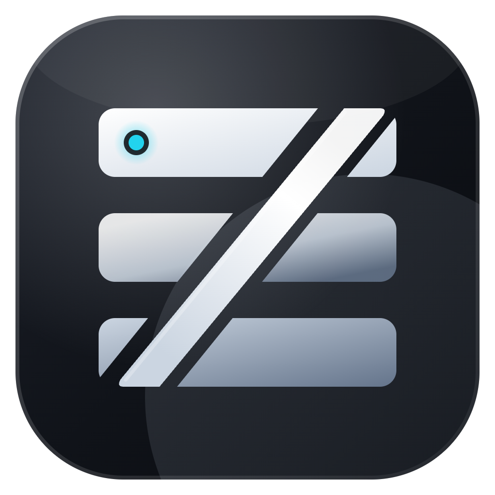
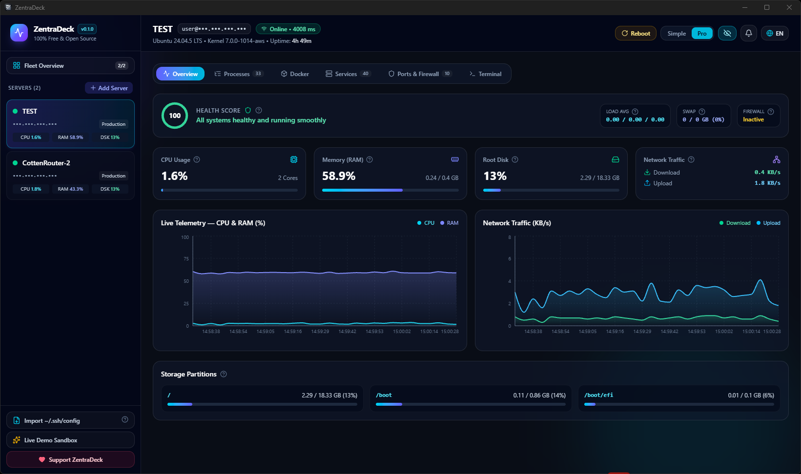
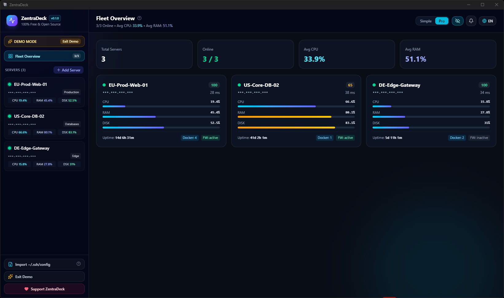
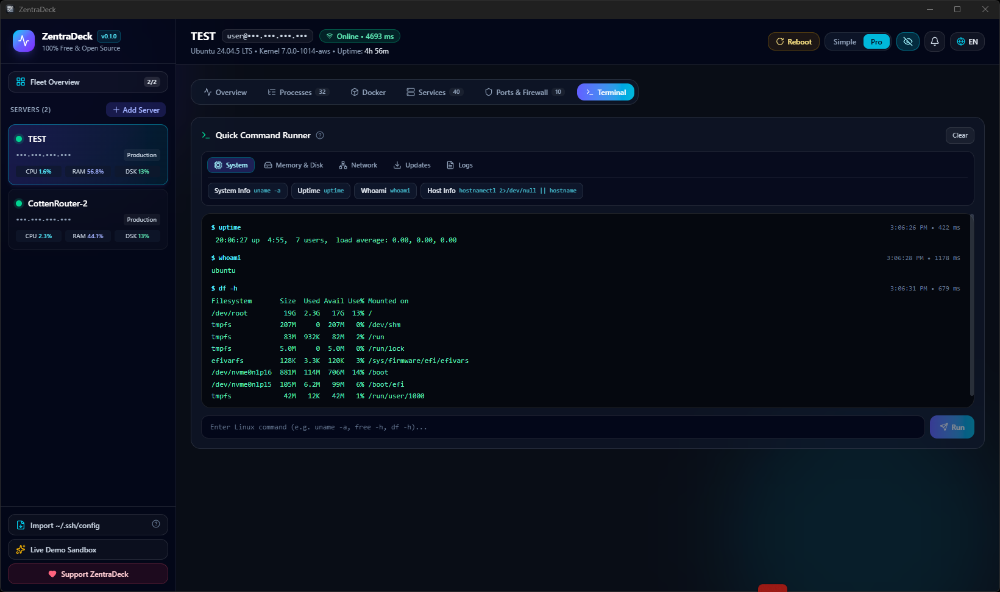

<div align="center">



# ZentraDeck

**Ultra-light, zero-telemetry Linux server command center over plain SSH — Multi-Server Broadcast & Snippets Vault, Security & SSL Audit, Visual Cron & Timers, Forensic History Reports, Interactive PTY Terminal, and Atomic SFTP Editor in a <15 MB Go core.**

[](https://github.com/CyberRhythm/ZentraDeck/releases)
[](LICENSE)
[](https://wails.io)
[](https://github.com/CyberRhythm/ZentraDeck/releases)

[Website](https://cyberrhythm.github.io/ZentraDeck/) • [Why ZentraDeck](#why-zentradeck) • [How It Compares](#how-it-compares) • [Features](#features-in-detail) • [Roadmap](#active-development--roadmap) • [Security & Audits](#security--transparency) • [Downloads](#downloads) • [Build from Source](#build-from-source)

</div>

---

<div align="center">



<p align="center">
  
  
</p>

</div>

---

## Why ZentraDeck?

Managing a fleet of Linux VPS boxes shouldn't force you to pick between two extremes:

1. **Installing heavy background monitoring agents** on 512 MB / 1 GB cloud instances, opening extra firewall ports, and maintaining another Docker stack just to check server health.
2. **Running 400+ MB Electron SSH apps** that bundle an entire Chromium runtime, require cloud accounts, and lock SFTP, Snippets, or basic features behind a monthly subscription.

**ZentraDeck** is a native desktop command center written in **Go + Wails + React** that talks to your servers strictly over standard SSH & SFTP. Point it at any Ubuntu, Debian, AlmaLinux, Rocky, CentOS, Fedora, Arch, or AWS EC2 server — you get live fleet telemetry, **Multi-Server Broadcast & Snippets Vault**, **1-Click Security & SSL Auditing**, **Visual Cron & Systemd Timers**, **Server History & Forensic Reports**, a full **Interactive PTY Terminal & Docker Shell**, an **Atomic SFTP File Manager & Quick Editor**, **System Tray alerts**, Docker/Systemd controls, a sortable Task Manager, and open-port inspection in seconds.

> **Honest footprint note:** ZentraDeck enforces Go runtime memory limits (`GOGC=25`, `GOMEMLIMIT=14 MiB`), automatic OS working-set trimming on Windows (`EmptyWorkingSet`), **`React.lazy` code-splitting** for heavy modules, and **`WebviewGpuIsDisabled: true`** on Windows — keeping the **Go core process under ~15 MB RAM** and cutting total Windows private RAM by over 50% (~191 MB total including OS-managed WebView2, with zero bundled Chromium per app).

**No server agent. No cloud account. Zero telemetry. 100% free and MIT-licensed.**

---

## How It Compares

Every tool has trade-offs. ZentraDeck is built for **fast, zero-agent desktop operations, live triage, multi-server command execution, security auditing, interactive SSH/PTY, and safe SFTP editing** — not as a replacement for multi-month Prometheus/Grafana time-series warehouses or cloud team sync.

| Capability | **ZentraDeck v0.4.0** | Electron SSH Clients *(Termius, Tabby)* | Agent Dashboards *(Netdata, Grafana)* | Web Panels *(Cockpit)* |
| :--- | :---: | :---: | :---: | :---: |
| **Zero Server Agent / No Extra Ports** | ✅ Pure SSH & SFTP | ✅ Pure SSH | ❌ Agent required | ❌ Daemon + Web Port |
| **Desktop Footprint** | **<15 MB Go core** + lean OS WebView | ~300–600 MB (bundled Chromium) | Browser + Server RAM | Browser + Server RAM |
| **Multi-Server Broadcast & Snippets Vault** | ✅ 23 built-in + custom (free) | ⚠️ Often paywalled (Termius) | ❌ | ❌ |
| **Security & SSL Audit + Visual Cron/Timers** | ✅ 1-click SSH audit & Cron UI | ❌ | ⚠️ Separate plugins | ⚠️ Partial |
| **Server History & Forensic Reports** | ✅ `sysstat`/`journald` + `.md`/`.txt` export | ❌ | ✅ Weeks/months TSDB | ⚠️ Basic / PCP plugin |
| **Interactive PTY Terminal + Docker Shell** | ✅ Full `@xterm/xterm` PTY | ✅ Rich PTY | ❌ | ✅ Web terminal |
| **SFTP File Manager & Config Editor** | ✅ Atomic writes + path guards | ⚠️ Often paywalled (Termius) | ❌ | ⚠️ Plugin |
| **System Tray & Native OS Alerts** | ✅ Per-server thresholds | ❌ | ✅ Web/Webhook alerts | ❌ |
| **CI-Audited Zero Telemetry** | ✅ Automated pre-release gate | ⚠️ Cloud-first / telemetry | ⚠️ Varies | ✅ Local |
| **OS Keychain + Write-Only Local Vault** | ✅ Never exposed to UI | ⚠️ Often readable / cloud-synced | N/A | N/A |
| **Per-Server SOCKS5 Proxy** | ✅ Built-in (free) | ⚠️ Paid / plugin | ❌ | ❌ |
| **Simple & Pro UI Modes (Free)** | ✅ Free toggle | ❌ Paid tiers | ❌ Complex setup | ⚠️ Fixed UI |
| **11 Languages (100% Complete + RTL)** | ✅ Every module, tooltip & report | ❌ Mostly English | ❌ | ⚠️ Partial |

---

## Features in Detail

### 1. Multi-Server Broadcast & Snippets Vault
- **Snippets Vault:** Save, categorize, and reuse your own SSH commands alongside **23 built-in commands** across **System**, **Storage**, **Network**, **Docker**, **Security**, **Logs**, and **Updates** — each with localized plain-language explanations.
- **Multi-Server Broadcast:** Run a single SSH command across multiple selected servers simultaneously with per-server output cards, one-click copy, and **destructive-command safety warnings** (`rm`, `reboot`, `shutdown`, `mkfs`).

### 2. Server History & Forensic Reports (`.md` / `.txt`)
- **Historical Trends & Crash Timelines:** Inspect historical CPU, RAM, Swap, Disk I/O Wait, Host CPU Steal, Load Average, and Network metrics via optional zero-daemon `sysstat` alongside native `journald`/`wtmp` reboot, crash, and OOM timelines.
- **Automated Diagnostics & Stability Score:** Surfaces root-cause findings automatically with an executive Stability Score.
- **One-Click Localized Export:** Save executive or full forensic reports directly to disk in automatic per-server subfolders (`.md` or `.txt`), formatted in your active interface language with configurable export path and format in Settings.

### 3. 1-Click Security & SSL Audit + Visual Cron & Systemd Timers
- **Agentless Security Scoring:** Audits SSH root/password policies, Fail2ban, host firewall (UFW/Firewalld/nftables), pending security updates, and **local SSL certificate expiry (`<30d` alerts via `openssl`)** — complete with "Why this matters" explanations and copyable remediation commands.
- **Visual Cron Job Manager & Systemd Timers:** Create and manage Cron schedules visually without memorizing cron syntax (with an optional raw expression toggle), plus a read-only **Systemd Timers** viewer with clear descriptions.

### 4. Interactive PTY Terminal & One-Click Docker Container Shell
Run full terminal UIs directly inside ZentraDeck without switching to an external SSH client:
- **Full Interactive PTY (`@xterm/xterm`):** Supports `htop`, `vim`, `nano`, `sudo`, full ANSI colors, live resize sync, fullscreen mode, font zoom (`Ctrl +/-`), right-click smart copy/paste, and `^C` interrupt.
- **One-Click Docker Shell:** Jump straight into any running container's interactive shell from the Docker tab and switch back to the host shell anytime.
- **Active Shell Security Badge:** Any server with a live background shell shows a green **`PTY`** badge in the sidebar so open root/SSH sessions are never forgotten.
- **Quick Command Runner & Presets:** Switch anytime to the streaming command runner with 5 categorized preset groups (**System**, **Memory & Disk**, **Network**, **Updates**, **Logs**), localized hover tooltips, command history (`↑`/`↓`), and a working Stop button.

### 5. Hardened SFTP File Manager & Atomic Quick Config Editor
Edit remote `.env`, `nginx.conf`, or `docker-compose.yml` files safely over SSH without opening FileZilla or WinSCP:
- **Atomic POSIX Writes:** Config saves are written to a temporary file first and atomically renamed while preserving original file permissions — preventing corrupted or half-written configs if your connection drops mid-save.
- **Pro Quick Editor:** Includes Undo/Redo (`Ctrl+Z`/`Ctrl+Y`), Find & Replace (`Ctrl+F`), Word Wrap, Copy All, Font Zoom (`Ctrl +/-`), Fullscreen (`F11`), and an unsaved-changes guard.
- **Built for High Latency:** Reuses multiplexed persistent SFTP channels (with a 90-second idle reaper and bounded buffers) and single-round-trip directory listing with clean symlink handling.
- **Safety Guards:** Blocks accidental deletion or renaming of critical Linux paths (`/`, `/etc`, `/etc/ssh`, `/etc/passwd`, `/boot`, `/usr`, etc.) and prevents opening binary, device, or oversized (>512 KB) files in the text editor.

### 6. System Tray Background Mode & Native Desktop Alerts
- **Quiet Background Monitoring:** Minimize ZentraDeck to the system tray (Windows & Linux) while keeping an eye on your servers with minimal idle memory.
- **Per-Server Custom Alert Rules:** Set independent **CPU**, **RAM**, **Disk**, and **Offline** thresholds per server and receive native OS desktop notifications (with **2-strike outage debouncing** so brief ping spikes never cause false alarms).

### 7. Per-Server Workspace Isolation
- **Instant (`0ms`) Context Switching:** Each server independently remembers its active tab, live PTY session, and cached SFTP directory path without reloading when you switch back.
- **Safe First Entry:** Opening a server for the first time always lands safely on **Overview** rather than dropping you straight into a live shell or file manager.

### 8. Zero-Agent SSH, Per-Server SOCKS5 Proxy & `~/.ssh/config` Import
- Connect via **Password** or **SSH Private Key** (`.pem`/`.key` picker or direct paste, with optional passphrase).
- **Per-Server SOCKS5 Proxy:** Route individual servers through a SOCKS5 proxy (with optional auth) without touching system-wide proxy settings.
- **One-Click `~/.ssh/config` Importer:** Import existing SSH hosts automatically or pick any custom SSH config file.

### 9. OS Keychain Vault (`AES-256-GCM`), SSH TOFU & One-Click Privacy Mode
- **OS Keychain + AES-256-GCM:** Credentials are encrypted locally with a 256-bit master key stored in your **OS Keychain** (Windows Credential Manager, macOS Keychain, or Linux Secret Service).
- **Strict Write-Only Secrets:** Passwords, SSH private keys, and proxy credentials are **never sent back to the frontend UI** — even DevTools cannot inspect saved secrets.
- **SSH Host Key Verification (`known_hosts` + TOFU):** Pins host keys on first connection and immediately blocks mismatched keys with the SHA-256 fingerprint to prevent MITM attacks.
- **One-Click Privacy Mode:** Mask all IP addresses and usernames across the entire UI instantly for screenshots or screen shares.

### 10. Fleet Overview, Task Manager, Docker, Upgraded Logs Modal & Ports
- **Fleet Overview & Health Score (0–100):** Monitor online/offline status, latency, uptime, Docker counts, firewall status, and live CPU/RAM/Network/Storage charts across your entire fleet.
- **Sortable Live Task Manager:** Pulls and merges top CPU and top RAM processes with localized Linux process descriptions; sort live by CPU %, RAM %, PID, or Command, with `SIGTERM` / `SIGKILL` controls in Pro Mode (PID 1 protected).
- **Docker, Systemd & Upgraded Logs Modal:** Start, stop, restart, launch container shells, and inspect `docker logs` / `journalctl` output in an upgraded modal with **Auto Line-Wrap**, **Copy All**, **Fullscreen Expansion**, and clean **LTR formatting**.
- **Open Ports & Firewall Inspector:** Inspect listening TCP/UDP ports (`ss -tulnp`), bound processes, and **UFW / firewalld** status.
- **Simple Mode & Pro Mode (Both Free):** Toggle cleanly between everyday essentials and deep operator controls with zero paywalls.

### 11. 100% Complete Localization Across 11 Languages (+ Persian RTL)
Every module — including Broadcast & Snippets, Security & Cron, History & Exported Reports, Alerts, Interactive PTY, SFTP/Editor, and Linux process/service tooltips — is **100% translated** across all 11 languages, including full **Persian (`فارسی`) RTL** with offline-bundled **Vazirmatn** (zero external CDN requests):

| Language | Native Name | Code | Layout |
| :--- | :--- | :---: | :---: |
| **English** | English | `en` | LTR |
| **Persian** | فارسی *(offline Vazirmatn)* | `fa` | **RTL** |
| **Chinese (Simplified)** | 简体中文 | `zh` | LTR |
| **Portuguese** | Português | `pt` | LTR |
| **Spanish** | Español | `es` | LTR |
| **German** | Deutsch | `de` | LTR |
| **French** | Français | `fr` | LTR |
| **Japanese** | 日本語 | `ja` | LTR |
| **Russian** | Русский | `ru` | LTR |
| **Korean** | 한국어 | `ko` | LTR |
| **Indonesian** | Bahasa Indonesia | `id` | LTR |

### 12. Interactive Live Demo Sandbox
Explore 3 simulated Linux nodes (`Web`, `Database`, `Edge Gateway`) offline with zero credentials, test Docker/Systemd actions, run commands, and trigger **Simulate Outage** to see alerts in action.

---

## Active Development & Roadmap

**ZentraDeck is actively developed, and with every update we strive to add more practical, community-requested features** — while keeping the application lightweight, local-first, zero-telemetry, and 100% free.

Planned highlights for upcoming releases include:
- **Customizable UI Themes:** A built-in Theme Picker (including clean neutral dark themes like Carbon/Zinc alongside classic dark and light options).
- **Encrypted Export / Import:** Password-protected local backup and transfer of your server inventory across multiple PCs without any cloud sync.
- **Continuous Feature Expansion:** More operator tools, security checks, and workflow improvements driven directly by your GitHub Issues and feedback.

---

## Security & Transparency

### Automated Pre-Release Security & Zero-Telemetry Gate
Every GitHub Actions release must pass the **`Pre-Release Security & Zero-Telemetry Audit`** job before any binary is built or published:
- **Zero-Telemetry Static Check:** Fails the build if any forbidden outbound HTTP client (`net/http`, `fetch`, `axios`, `XMLHttpRequest`, `WebSocket`, `sendBeacon`) or dangerous DOM sink (`eval`, `innerHTML`, `dangerouslySetInnerHTML`) exists in source code.
- **Vulnerability Scanning:** Runs `go vet`, **`govulncheck`** (on the latest patched stable Go toolchain), and **`npm audit --omit=dev --audit-level=high`**.
- **Cryptographic Integrity:** Generates **`SHA256SUMS.txt`** for every release artifact.
- **Strict Local Permissions & Hardened OS Integration:** Enforces `0600` / `0700` file permissions on encrypted credentials, SSH known hosts, SFTP backups, snippets, and exported reports, while Windows toast notifications invoke the explicit `System32` PowerShell binary with XML-escaped, Base64-encoded payloads.

### Zero Data Collection Guarantee
- **No telemetry, no analytics, no tracking, and no crash reporters.**
- **No cloud sync or external servers** — inventory, credentials, and settings stay 100% local on your machine.
- **Zero outbound connections** except to the SSH servers (and optional SOCKS5 proxies) you explicitly configure.

### Read-Only Telemetry Commands
Every metric poll runs a single read-only shell block over your encrypted SSH session using standard Linux utilities:
- System & CPU: `hostname`, `/etc/os-release`, `uname -r`, `/proc/uptime`, `/proc/stat`, `nproc`, `/proc/loadavg`
- Memory, Disk & Network: `/proc/meminfo`, `df -kP`, `/proc/net/dev`
- Operations & Security: `ps`, `systemctl`, `ss -tulnp`, `ufw` / `firewall-cmd`, `openssl` (for local SSL audit), `sar` / `journalctl` (on-demand history), and `docker ps -a` (only if `docker` exists)

Active actions (`systemctl`, `docker`, `kill`, `reboot`, PTY, SFTP, Broadcast, Cron) only run when you explicitly trigger them, and destructive actions always require confirmation.

---

## Downloads

All **17 release packages + `SHA256SUMS.txt`** are audited and built automatically via GitHub Actions on every release:

| Platform | Architectures | Packages |
| :--- | :--- | :--- |
| **Windows** | `amd64`, `arm64` | Installer (`.exe` NSIS), Portable (`.zip`) |
| **macOS** | Universal (`Apple Silicon` + `Intel`) | Installer (`.dmg`), Portable (`.zip`) |
| **Linux (Universal)** | `amd64`, `arm64` | `.AppImage`, Portable (`.tar.gz`) |
| **Debian / Ubuntu / Mint / Pop!_OS** | `amd64`, `arm64` | `.deb` |
| **Fedora / RHEL / Rocky / openSUSE** | `amd64`, `arm64` | `.rpm` |
| **Arch / Manjaro / EndeavourOS** | `amd64`, `arm64` | `.pkg.tar.zst` |

👉 **[Download the latest release here](https://github.com/CyberRhythm/ZentraDeck/releases)**

### Verify SHA-256 Checksums
```bash
sha256sum -c SHA256SUMS.txt --ignore-missing
```

### Note on Unsigned Binaries (Windows SmartScreen & macOS Gatekeeper)
ZentraDeck is an independent, free open-source project and binaries are currently **not code-signed** with a paid EV / Apple Developer certificate:
- **Windows (SmartScreen):** Click **More info** → **Run anyway**.
- **macOS (Gatekeeper):** Open **System Settings → Privacy & Security → Open Anyway**, or run:
```bash
xattr -cr /Applications/ZentraDeck.app
```
- **Prefer to verify or compile yourself?** Check `SHA256SUMS.txt` or build from source in minutes below.

---

## Build from Source

### Prerequisites
- [Go 1.24+](https://go.dev/dl/)
- [Node.js 22+](https://nodejs.org/)
- [Wails CLI v2](https://wails.io/docs/gettingstarted/installation)
- **Linux only (Debian/Ubuntu 24.04+):**
```bash
sudo apt-get install -y libgtk-3-dev libwebkit2gtk-4.1-dev libayatana-appindicator3-dev pkg-config
```

### Build Commands
```bash
git clone https://github.com/CyberRhythm/ZentraDeck.git
cd ZentraDeck

# Run with hot reload
wails dev

# Build native production binary (Windows / macOS)
wails build -clean

# Build native production binary (Linux with WebKit2GTK 4.1)
wails build -clean -tags webkit2_41
```

---

## Support & Contributing

ZentraDeck is built and maintained independently — free forever, with no ads or locked features.
- ⭐ **Star this repository** if ZentraDeck earns a spot in your toolkit.
- 🐛 **Issues & PRs** are always welcome — whether it's a bug fix, distro packaging tweak, or an extra language translation.
- ❤️ Optional crypto support is available directly inside the app via **Support ZentraDeck**.

---

## License

Released under the [MIT License](LICENSE).